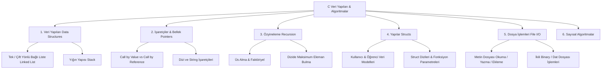

# 🧩 C Data Structures & Algorithms Library

[-blue?style=flat&logo=c)](https://en.cppreference.com/w/c)
[](https://github.com/)
[](LICENSE)

Bu depo, **C programlama dili** ile geliştirilmiş temel veri yapıları (Data Structures), bellek yönetimi (Dynamic Memory Allocation), işaretçiler (Pointers), özyineleme (Recursion), dosya işlemleri (File I/O) ve algoritma pratiklerini tek bir çatı altında toplayan kapsamlı bir referans kütüphanesidir.

---

## 📚 Konu Başlıkları ve İçerik Haritası



---

## 🗂️ Dosya ve Kategori Rehberi

### 1. 🔗 Bağlı Listeler (Linked Lists)
* `doublelinkedlist.c` - Çift yönlü bağlı liste (Doubly Linked List) ekleme, silme ve traversal mantığı.
* `linkedlis1.c`, `linkedlistdeneme1.c` - Tek yönlü bağlı liste (Singly Linked List) düğüm oluşturma ve arama.

### 2. 🥞 Yığın (Stack) Yapısı
* `stack1.c` - LIFO (Last In First Out) prensibine göre push, pop ve peek operasyonları.

### 3. 🎯 İşaretçiler & Bellek Yönetimi (Pointers & Memory)
* `CallByValuepointertanimlama.c` & `CallByReferancepointer.c` - Değer ve referans ile aktarım arasındaki farklar.
* `pointerarray1.c`, `pointrarrray2.c` - İşaretçi aritmetiği ve dizi indeksleme.
* `pointerstring1.c` - Karakter dizileri (strings) ve işaretçi manipülasyonu.
* `ornekpointer1.c`, `ornekpointer2.c` - Dinamik bellek ve işaretçi pratikleri.

### 4. 🔄 Özyineleme (Recursion)
* `rekursif.c`, `rekursifusalma.c`, `rekusifusalmaiki.c` - Özyinelemeli üs alma ve matematiksel fonksiyonlar.
* `rekursifmax.c` - Dizi içerisindeki en büyük elemanı özyinelemeli arama algoritması.

### 5. 🏗️ Yapılar (Structs)
* `structornek4.c`, `structornek5.c`, `structornek6.c` - Özel veri tipleri oluşturma, struct içinde dizi tutma ve fonksiyonlara struct aktarımı.

### 6. 📁 Dosya Yönetimi (File I/O)
* `dosyaacma1.c`, `dosyaislemleri2.c`, `dosyaislemleri3.c` - Dosya açma modları (`r`, `w`, `a`), `fprintf`, `fscanf`, `fgets` kullanımı.

### 7. 🧮 Sayısal Algoritmalar & Sınav Hazırlık
* `numericodev.c`, `numericodev3.c` - Sayısal yöntemler ve matematiksel analiz algoritmaları.
* `dizibirlestirme.c`, `diziornekleri4.c` - Dizi sıralama ve birleştirme (merge) pratikleri.

---

## 🚀 Kodları Derleme ve Çalıştırma

Herhangi bir C derleyicisi (GCC, Clang veya MinGW) ile:

```bash
# GCC ile derleme
gcc -o program doublelinkedlist.c

# Çalıştırma (Windows)
./program.exe

# Çalıştırma (Linux / macOS)
./program
```

---

## 👨‍💻 Geliştirici

* **Furkan Topal** - [GitHub Profili](https://github.com/furkantopaldev)
